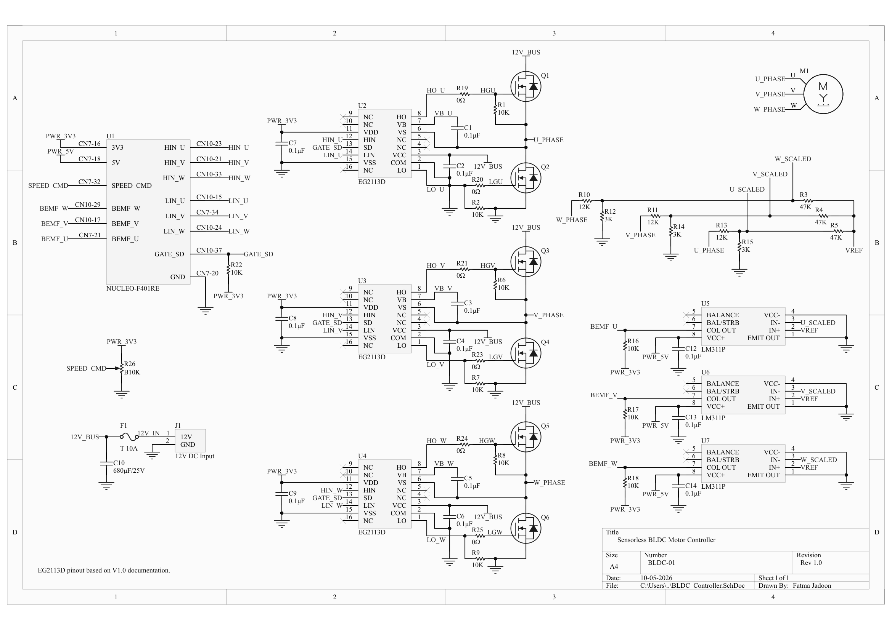

# Sensorless BLDC Motor Controller
12V sensorless three-phase BLDC motor controller designed around an STM32 NUCLEO-F401RE. Controller implements six-step commutation, open-loop control, closed-loop control, and back-EMF zero-cross detection.

## Tools
- STM32 NUCLEO-F401RE
- C
- GDB
- Altium Designer
- STM32CubeIDE

## Schematic

## Features
### Firmware
- Six-step trapezoidal BLDC commutation
- Sensorless rotor-position detection using back-EMF
- Open-loop startup
- Automatic transition to closed-loop commutation
- Automatic fallback to open-loop control
- Speed control using PWM

### Hardware
- Three-phase MOSFET inverter
- EG2113D half-bridge gate-driver circuitry
- Back-EMF zero-cross detection
- Virtual-neutral reference
- Power-input protection
- STM32 control interfaces for PWM, BEMF sensing, shutdown, and speed control

## System Overview

STM32 generates three PWM high-side control signals and three low-side switching signals. The power stage drives the three motor phases using six MOSFETs.

During sensorless operation, the floating motor phase is monitored for back-EMF. Comparator outputs generate interrupts when the floating phase crosses the virtual neutral voltage. These zero-crossing events are used to estimate rotor position and schedule the next commutation.

## Hardware
| Component | Purpose |
| --- | --- |
| STM32 NUCLEO-F401RE | MCU |
| 6x IRF540N MOSFET | Three-phase inverter |
| 3x EG2113D | Half-bridge gate drivers |
| LM311 comparators | Back-EMF zero-cross detection |
| 12kΩ/3kΩ divider | Motor phase voltage dividers |
| 3x 47kΩ resistors | Virtual neutral reference |
| 10kΩ potentiometer | Speed input |
| 680µF capacitor | DC-link capacitor |
| 12V DC supply | Motor power source |
| 10A time-delay fuse | Overcurrent protection |
| 0Ω resistors | Gate-resistor placeholders |

## Control Architecture
Motor operation is controlled using a finite-state machine with five states:
- `OFF`
- `ALIGNMENT`
- `OPEN_LOOP`
- `CLOSED_LOOP`
- `SHUTDOWN`

### OFF
- Controller is inactive and all motor-drive outputs are disabled
- Resets commutation timing and control flags
- If the potentiometer requests a speed above minimum threshold, transition to `ALIGNMENT`

### ALIGNMENT
- Controller applies a fixed commutation state for 200 ms to force the rotor into a known electrical position
    - Phase U - high-side PWM
    - Phase V - low-side enabled
    - Phase W - floating
- Once alignment is complete, transition to `OPEN_LOOP`

### OPEN_LOOP
- Controller performs predefined six-step commutation
    - Required because the motor initially rotates too slowly to generate reliable back-EMF signals
- Gradually adjusts commutation interval toward the interval corresponding to the requested motor speed
- Back-EMF is monitored: if > 4/6 commutations contain valid zero-crossing events, transition to `CLOSED_LOOP`
- If the potentiometer requests a speed below minimum threshold, transition to `OFF`

### CLOSED_LOOP
- Controller uses back-EMF zero-crossing timestamps to determine when the next commutation should occur
- For each valid zero crossing:
    - Controller estimates the commutation interval based on time between the previous commutation and the detected zero crossing
    - Schedules the next commutation
    - PWM duty cycle adjusted based on the difference between measured and requested commutation intervals
- If back-EMF becomes unreliable, transition to `OPEN_LOOP`
- If the potentiometer requests a speed below minimum threshold, transition to `OFF`

### SHUTDOWN
- Controller enters `SHUTDOWN` when fault flag asserted
- All high and low-side MOSFETs are disabled
- Gate-driver shutdown signal is enabled
- Controller stays in `SHUTDOWN` until system is reset

## Six-Step Commutation
During each commutation step:
- One phase driven high
- One phase driven low
- One phase floating (for back-EMF sensing)

| Step | High-Side Phase | Low-Side Phase | Floating Phase |
| --- | --- | --- | --- |
| 1 | U | V | W |
| 2 | U | W | V |
| 3 | V | W | U |
| 4 | V | U | W |
| 5 | W | U | V |
| 6 | W | V | U |

## Back-EMF Detection
- Each motor phase compared against a virtual-neutral reference
- Comparator outputs connected to STM32 GPIO pins configured for rising and falling-edge interrupts
- For each commutation step, firmware stores:
    - The expected floating phase
    - The expected zero-crossing edge
- When an interrupt occurs:
    - Controller checks whether the measured phase and edge match the expected values
    - If both match, the zero crossing is marked as valid and its timestamp is recorded

### BEMF Cooldown Period
- MOSFET switching can produce transients immediately after commutation
- To prevent these signals from being interpreted as valid zero crossings, controller ignores BEMF interrupts for a short period after each commutation

### BEMF Stability
- The controller stores the validity of the six most recent commutations
- Back-EMF is considered stable when > 4/6 recent commutations contain valid zero crossings

## Speed and Timing
- For six-step commutation, one electrical revolution = six commutation steps
- Commutation interval ``T_comm`` calculated from mechanical RPM using ``T_comm = 60,000,000 / (RPM * pole pairs * 6)``
- For this design:
    - Calculations assume a 3-pole-pair motor
    - Potentiometer ADC value is directly used as the requested motor RPM

## STM32 Peripheral Configuration

### TIM1 - PWM Generation
TIM1 generates PWM for the three high-side gate-driver inputs
| Parameter | Value |
| --- | --- |
| PWM frequency | 20 kHz |
| Default duty cycle | ~60% |
| Maximum duty cycle | ~80% |

### TIM2 - Control Timing
TIM2 runs at 1 MHz to provide a 1 µs timer for commutation, BEMF timing, and state transitions

### ADC1 - Speed Input

ADC1 reads potentiometer for speed control

### GPIO/EXTI

Three GPIO inputs receive the comparator outputs for phases U, V, and W

## Firmware Structure
| Function | Purpose |
| --- | --- |
| `control_fsm()` | Implements FSM |
| `step_commutation()` | Advances to next commutation |
| `HAL_GPIO_EXTI_Callback()` | Processes back-EMF comparator interrupts |
| `is_bemf_stable()` | Checks the six most recent BEMF results, considers BEMF stable when > 4/6 are valid |
| `rpm_to_elec_comm()` | Converts mechanical RPM into corresponding electrical commutation interval |
| `update_pwm()` | Adjusts PWM duty cycle based on difference between the measured and requested commutation interval |
| `get_pot_value()` | Reads potentiometer |
| `get_curr_time()` | Returns current time (microseconds) |

## Testing
Motor-control logic was tested using mocked STM32 behavior. Tested both individual functions and FSM behavior.

### Unit Tests
- Timing and RPM calculations
- PWM control
- Six-step commutation
- BEMF detection and validation
- BEMF cooldown behavior
- FSM behavior

### Integration Tests
- Startup sequence: `OFF` -> `ALIGNMENT` -> `OPEN_LOOP`
- `OPEN_LOOP` -> `CLOSED_LOOP`
- `CLOSED_LOOP` -> `OPEN_LOOP` fallback
- `CLOSED_LOOP` commutation scheduling
- Stop, shutdown, and restart behavior

## Future Improvements
- Current sensing
- PCB layout and fabrication
- Improved ISR/main-loop synchronization
- Validation on STM32 board
